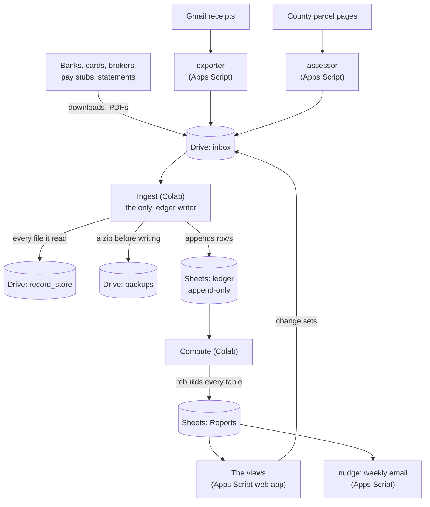
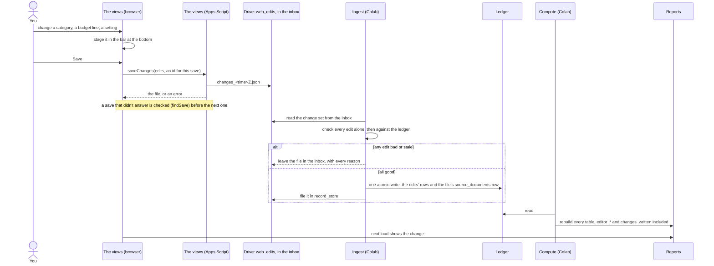

# How it fits together

Where the data lives, which piece reads and writes what, and the path an edit takes from the page to the
ledger. The reasons behind these choices are in [decisions.md](decisions.md); what each piece does in detail
is in the other pages.

## The pieces

Everything runs under the owner's own Google sign-in. Nothing in this repo stores data or credentials.

- **The inbox** is the only way in. A bank download, a statement, a seed file and an edit made in the views
  are all files dropped there, and ingest reads each the same way: identify it, check it, and file it.
- **The ledger** keeps every row ingest ever wrote. A correction is a new row, never an edit of an old one.
- **Reports** is rebuilt from the ledger by every compute. Nothing else writes it, and nothing in it is
  the only copy of anything.
- **The views** read Reports and never write the ledger: an edit becomes a change set in the inbox.
- **The Apps Scripts** (exporter, assessor, nudge) each do one small job on a schedule and are set up once
  ([apps-scripts.md](apps-scripts.md)).

## Inside the engine

`runner.run` calls the stages through `engine`, in order:

| Module | What it does |
| --- | --- |
| `stage_legacy` | The old workbooks into the ledger, once each; safe to run every time |
| `stage_ingest` | Every file in the inbox into the ledger, then review answers and prices |
| `stage_compute` | Reports rebuilt from the ledger |
| `ledgerio` | Opens the ledger and Reports, and reads the ledger the way compute sees it |
| `books` | The transactions as both stages reason about them |
| `runlog` | What each stage prints, kept for the views' Status page |
| `parsers/` | One module per kind of file: `sniff` says whether it is one, `parse` reads it |
| `retirement/` | The retirement plan: model, Social Security, tax, simulation, reports, inputs |

The rest of the package is the domain: categorization, budget, flows, investments, lots and wash sales,
taxes by year and state, mortgage, homes. Each takes frames read from the ledger and returns frames for
Reports, so it can be tested without Google.

## An edit, from the page to the page

The details of each step, and how a discard or a lost answer is handled, are in
[views.md](views.md#editing-in-the-views).
